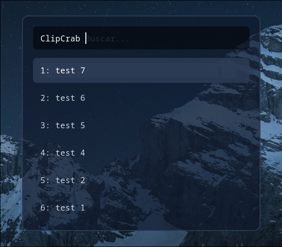

# ClipCrab 🦀

[](https://github.com/IgnacioBarboza/Clipboard-Manager/actions/workflows/ci.yml)
[](LICENSE)

A lightweight clipboard history manager for Wayland, written in Rust.

ClipCrab runs in the background, remembers the last things you copied (text and images)
and lets you bring any of them back through a [rofi](https://github.com/davatorium/rofi) menu.



## Features

- **Text and image history.** Images are stored on disk and shown as thumbnails in the menu.
- **No duplicates.** Copying something that is already in the history moves it to the top.
- **Bounded memory.** A fixed-size circular buffer keeps the last 10 entries and drops the oldest.
- **Survives restarts.** History is persisted and reloaded when the daemon starts.
- **Private by default.** The history file and image cache are only readable by your user.
- **Small.** One binary with four dependencies. It has no GUI toolkit; it uses the rofi you already have.

## Requirements

- A Wayland compositor that supports the **data-control** protocol:
  Hyprland, Sway, river, niri, KDE Plasma and other wlroots-based compositors.
  GNOME/Mutter does not support it.
- [`wl-clipboard`](https://github.com/bugaevc/wl-clipboard), which provides `wl-copy`.
- [`rofi`](https://github.com/davatorium/rofi) 1.7.6 or newer (native Wayland support).
- `notify-send` (libnotify) for notifications.
- Rust 1.93 or newer to build from source.

On Arch Linux:

```sh
sudo pacman -S wl-clipboard rofi libnotify rust
```

## Installation

```sh
git clone https://github.com/IgnacioBarboza/Clipboard-Manager.git clipcrab
cd clipcrab
cargo install --path .
```

This installs the `clipcrab` binary into `~/.cargo/bin`. Make sure that directory is in your `PATH`.

## Usage

ClipCrab has two modes:

| Command           | What it does                                                         |
| ----------------- | -------------------------------------------------------------------- |
| `clipcrab`        | Starts the daemon that listens for copies and records the history.   |
| `clipcrab --menu` | Opens the history in rofi. The selected entry goes back to the clipboard. |

Start the daemon with your session and bind the menu to a key.

### Hyprland

```ini
# ~/.config/hypr/hyprland.conf
exec-once = clipcrab
bind = SUPER, V, exec, clipcrab --menu
```

### Sway

```
# ~/.config/sway/config
exec clipcrab
bindsym $mod+v exec clipcrab --menu
```

### systemd (optional)

If your session imports `WAYLAND_DISPLAY` into the systemd user environment (for example with uwsm),
you can run the daemon as a user service instead of `exec-once`:

```sh
mkdir -p ~/.config/systemd/user
cp contrib/clipcrab.service ~/.config/systemd/user/
systemctl --user enable --now clipcrab.service
```

## Where data is stored

| Data            | Location                                    | Permissions |
| --------------- | ------------------------------------------- | ----------- |
| History         | `$XDG_STATE_HOME/clipcrab/state.json` (default `~/.local/state/clipcrab/`) | `0600` |
| Copied images   | `$XDG_CACHE_HOME/clipcrab/images/` (default `~/.cache/clipcrab/images/`)   | `0700` dir, `0600` files |

Images that are no longer referenced by the history are deleted when the daemon starts.
To wipe everything, stop the daemon and remove both directories.

> **Privacy note:** the history is stored as plain text. Anything you copy, including passwords
> copied from a password manager, ends up in `state.json` until it is pushed out of the history.

## How it works

```
 Wayland compositor
        │ data-control events
        ▼
 ┌──────────┐  push  ┌─────────────────┐  save  ┌──────────────┐
 │  daemon  │ ─────▶ │ circular buffer │ ─────▶ │  state.json  │
 └──────────┘        │ (last 10 items) │        │ + images/    │
                     └─────────────────┘        └──────┬───────┘
                                                       │ load
 ┌──────────┐ select ┌─────────────────┐               │
 │   rofi   │ ◀───── │ clipcrab --menu │ ◀─────────────┘
 └──────────┘        └────────┬────────┘
                              │ wl-copy
                              ▼
                          clipboard
```

The daemon and the menu are the same binary. They share state only through the history file,
which is written atomically (write to a temp file, then rename), so the menu never reads a partial file.

Each concern lives behind a small trait, which keeps the backends replaceable:

| Module | Responsibility |
| --- | --- |
| [`main.rs`](src/main.rs) | CLI, daemon loop and rofi menu. |
| [`circular_trait.rs`](src/circular_trait.rs) / [`circular_impl.rs`](src/circular_impl.rs) | `CircularLog`: the bounded history, backed by `circular-buffer`. |
| [`instance_trait.rs`](src/instance_trait.rs) / [`instance_impl.rs`](src/instance_impl.rs) | `ClipboardInstance`: reading (`wl-clipboard-rs`) and writing (`wl-copy`) the clipboard. |
| [`pager_trait.rs`](src/pager_trait.rs) / [`pager_impl.rs`](src/pager_impl.rs) | `Pager`: desktop notifications through `notify-send`. |
| [`state.rs`](src/state.rs) | Persisting and loading the history. |
| [`storage.rs`](src/storage.rs) | Image cache, XDG paths and cleanup. |

## Development

```sh
cargo fmt --check
cargo clippy --all-targets -- -D warnings
cargo test
```

CI runs the same checks on every push and pull request.

The [`research/`](research/) folder holds the small experiments that led to this design,
such as different GUI toolkits and clipboard crates. See [research/README.md](research/README.md).

## Known limitations

- The history size is fixed at 10 entries (`HISTORY_SIZE` in [`src/circular_impl.rs`](src/circular_impl.rs)).
- Only text and images are recorded. Other content types, such as files copied from a file manager,
  trigger a "not supported" notification.
- Only the regular clipboard is tracked, not the primary (middle-click) selection.

## License

[MIT](LICENSE) © Ignacio Barboza
